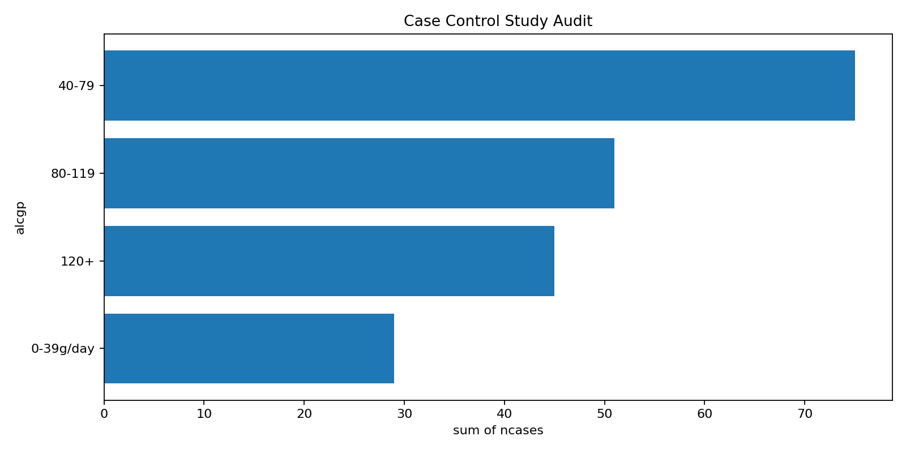

# Case Control Study Audit — executed results

## Decision question
How are sampled cancer cases distributed by alcohol group?

## Evidence
The largest observed sum of ncases is 75.000 for 40-79. This ranking is descriptive, not a recommendation.

Raw rows: 88. Rows used: 88. Excluded for missing/nonfinite required values or invalid denominator: 0.

## Method
Sum recorded ncases within each alcgp category; the row grain is an aggregated cell.

## Interpretation and limitations
Case counts are sampled study counts, not population cancer incidence or risk; age and tobacco confound comparisons. No causal inference, significance claim or production deployment is implied. Missing values are not imputed; identical rows are retained. Small or repeated samples limit uncertainty interpretation.

## Recommended next decision
Use appropriate case-control odds models with adjustment for age and tobacco.

## Reproducibility
Source and exact downloaded-byte SHA256 are recorded in run_manifest.json. SQL results are in answer.csv and analysis.sqlite. Review quality_audit.csv before interpretation.
